<div align="center">

# Orbit Start

**A fast, lightweight and fully customizable Start menu for Windows 11, written in Rust.**

One ~650 KB executable · no installer · no runtime · nothing injected into Explorer

[Download](../../releases/latest) · [Features](#features) · [Screenshots](#screenshots) · [Build](#build-from-source) · [العربية](#بالعربية)

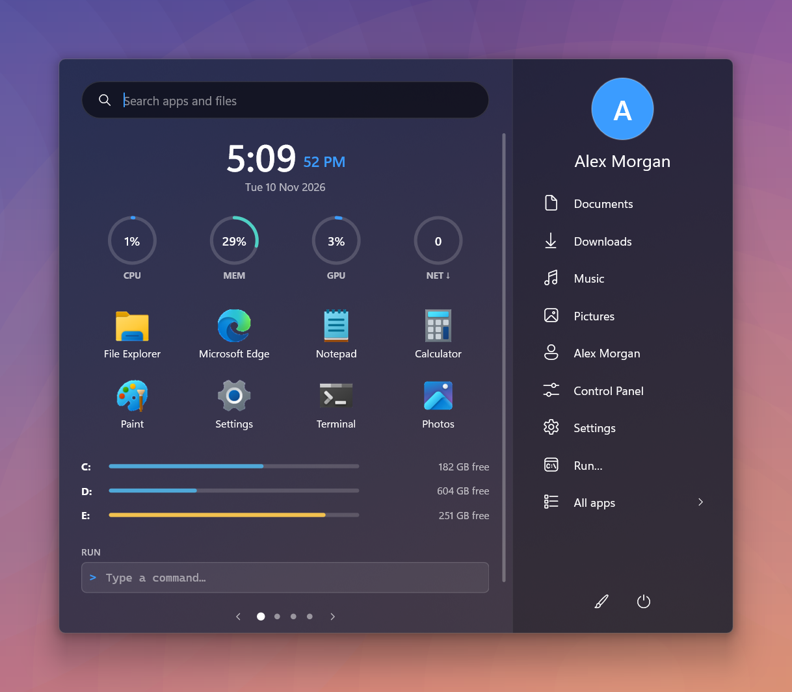

</div>

---

## Why

The Windows 11 Start menu is slow to open, hard to customize and mostly shows
recommendations. Orbit Start replaces it with a menu that opens instantly,
shows the things you actually use (live system stats, your drives, your own
app groups, notes, a calculator, a command box) and lets you change almost
everything about how it looks.

It is drawn directly with Direct2D and DirectComposition, with no web view and
no UI framework, so it stays small: about **35 MB of memory while closed**
(2 MB of it resident) and **no CPU at all** when the taskbar extras are off.

## Features

### Start menu
- **Four layouts**: two pane, compact, dashboard (widgets as cards), and apps
  (widgets on the left, the full app list always visible on the right).
- **Pages of widgets** you can reorder, add and remove; switch pages with the
  arrows, the dots, the keyboard or the mouse wheel.
- **Looks**: acrylic, blur, mica or solid backdrop · six themes including a light
  one · seven accent colours or the Windows accent · tint, size and icon size ·
  four screen positions · a short open animation.
- **Layout gallery** with ready-made looks, plus **export / import** of your
  layout as a JSON file to share it (notes and pinned apps are never exported).

### Widgets
| | |
| --- | --- |
| Clock and date | Analogue **world clocks**: click them to pick from 80 cities |
| **CPU, memory, GPU, network** gauges | **Drives**: one bar per drive; hover for used / total, click to open |
| Month **calendar** | **Notes** (saved automatically) |
| **Calculator** | **Run** box with history (↑ / ↓) |
| **Pinned apps** | **App groups** with tabs (see below) |
| **Downloads** folder | **Recent files** |
| **Open windows** | **Recently closed** apps, one click to reopen |
| **News** from any RSS / Atom feed | **Workspaces**: open a set of apps in one click |

### App groups
- A **Suggested** tab with the apps you use most, from the usage counts Windows
  already keeps, plus automatic **Productivity, Development, Internet, Media,
  Games** tabs ordered by use.
- **Your own groups**: press **+**, type a name, tick the apps. Each group gets
  *Choose apps*, *Rename* and *Open all*. Right-click any app for
  *Add to …* / *Remove from …*.

### Search
- Apps (ranked by how much you use them), **30 Windows Settings pages**, files
  and folders in your main folders, power commands, **inline maths**, web
  addresses and paths.
- Grouped results with a large **Best match**, matching letters highlighted.
- `> command` runs a command line · **Ctrl+Enter** runs an app as
  administrator · **Tab** jumps to the next group.

### Taskbar (from the outside, nothing injected)
- Opens from the **Windows key**, **Ctrl+Esc** and the **taskbar Start button**.
- **Rounded** or **Islands** taskbar shape. Switching back, or quitting, restores
  the normal taskbar; if the app is killed, the next launch restores it.
- **Taskbar islands** in the free space on the left: download / upload speed,
  CPU and memory (click for Task Manager) and quick buttons for Downloads,
  Documents and your user folder. They hide during full-screen apps.

## Screenshots

| | |
| --- | --- |
| 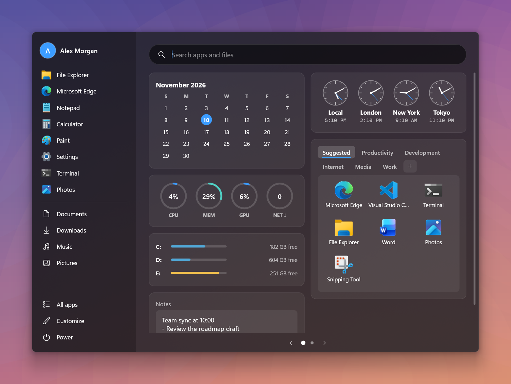 | 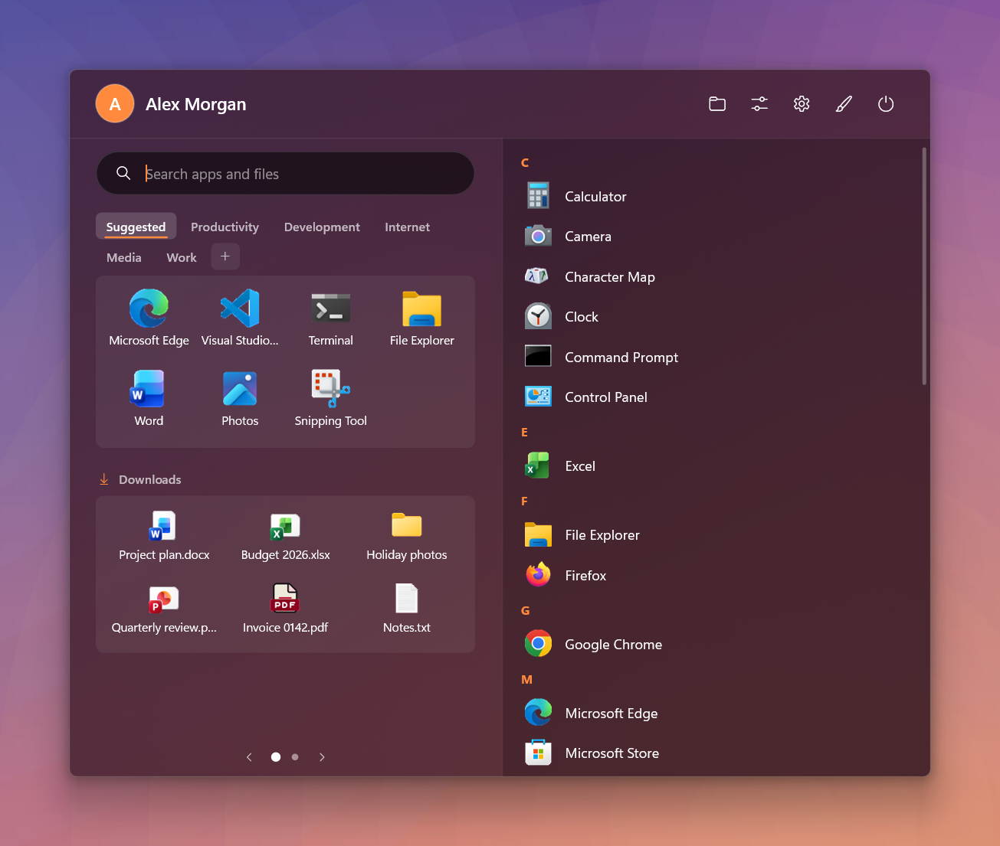 |
| Dashboard layout | Apps layout with the app list on the right |
| 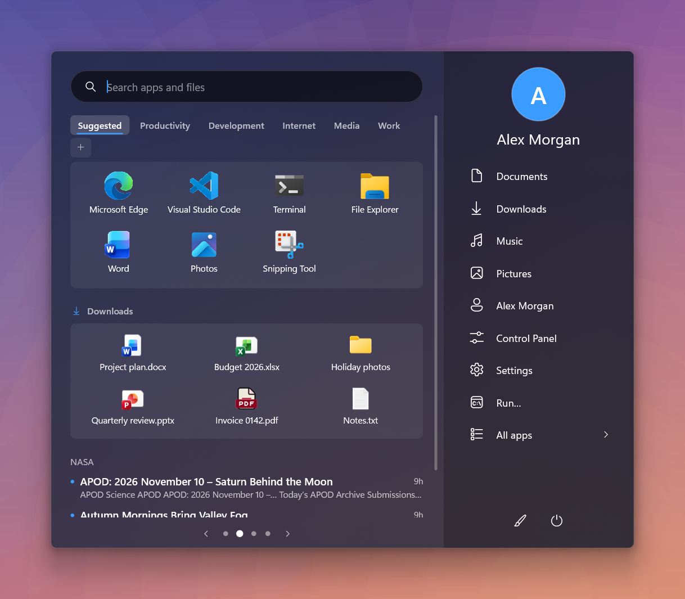 | 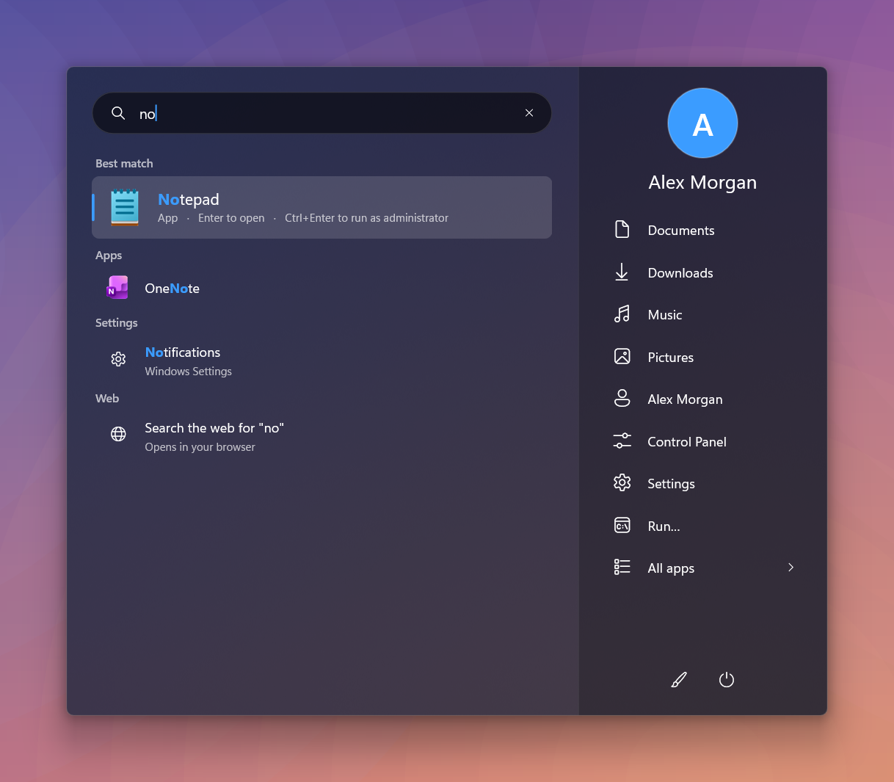 |
| App groups with tabs, Downloads, news | Search with a best match and highlighting |
| 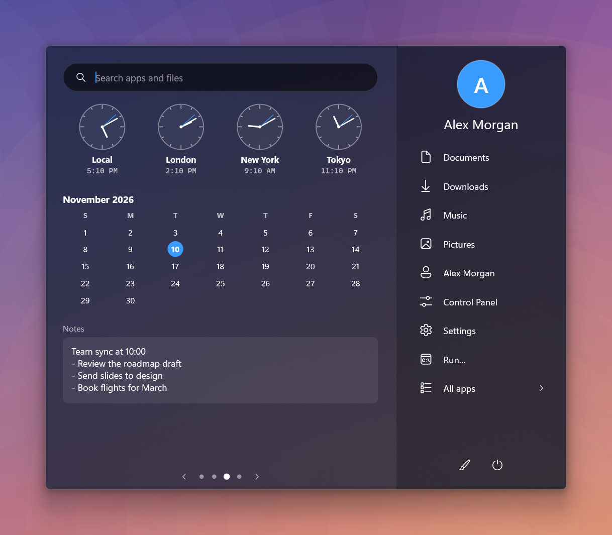 | 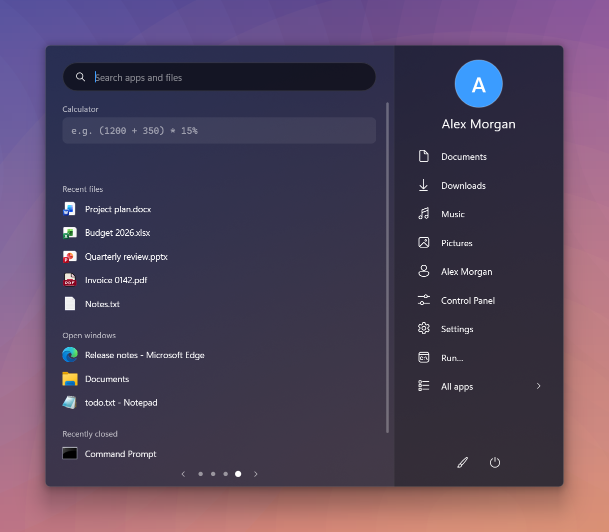 |
| World clocks, calendar, notes | Calculator, recent files, open and recently closed windows |
| 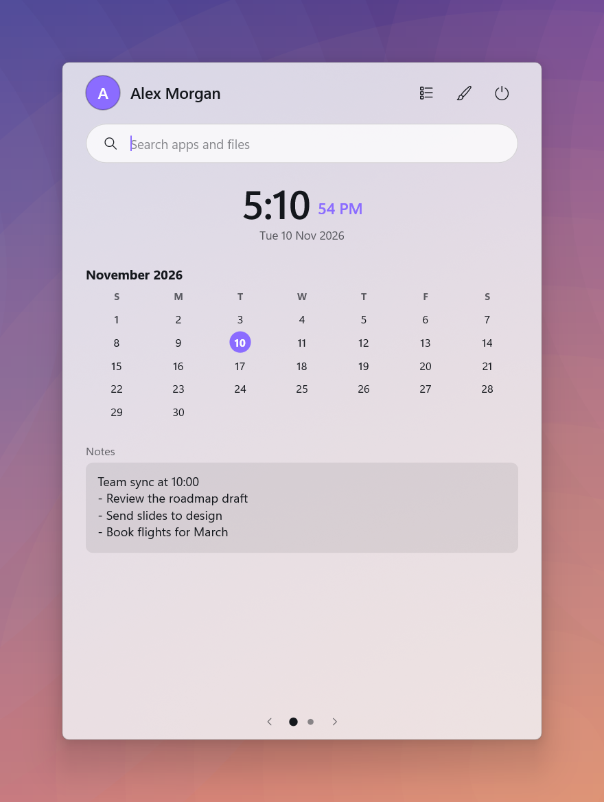 | 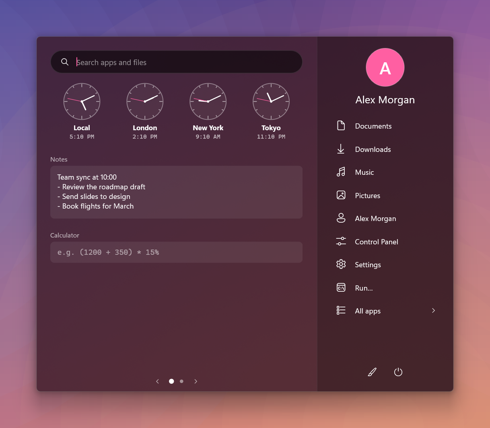 |
| Compact layout, light theme | Two pane, wine theme |
|  | 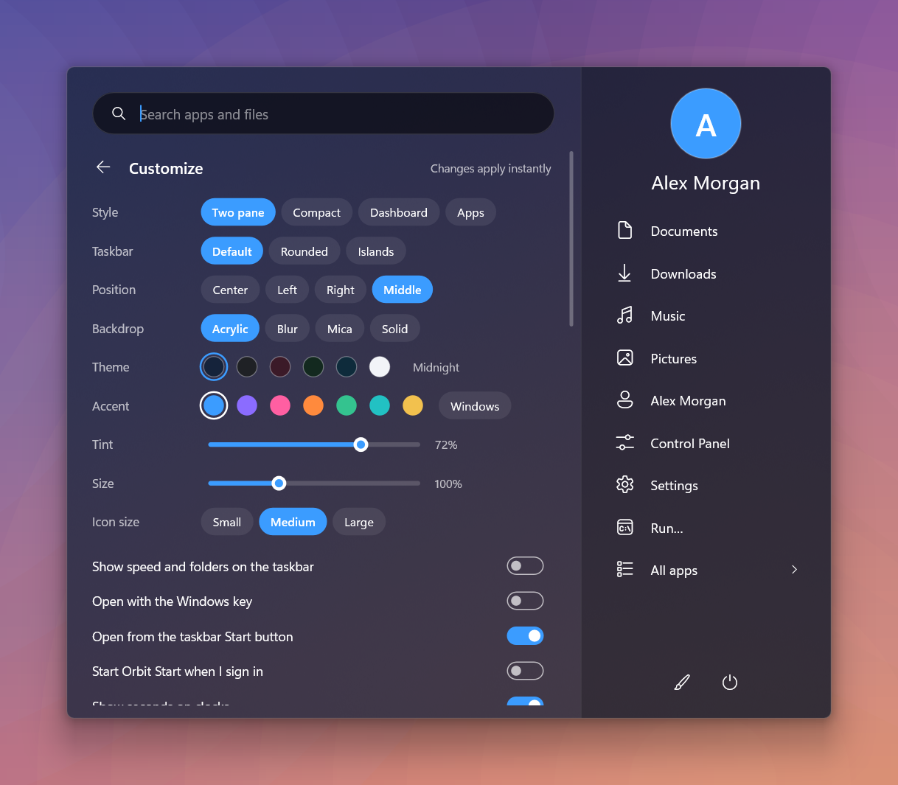 |
| Inline maths in search | Customize, changes apply instantly |

Taskbar islands:

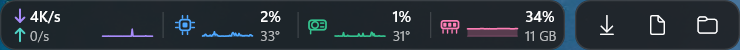

<sub>Screenshots are taken with the built-in `--demo` mode, which shows a made-up
user, files and drives.</sub>

## Install

1. Download `orbit-start.exe` from the [latest release](../../releases/latest)
   and put it in a folder of your own, for example `C:\Tools\OrbitStart`.
2. Double-click it. It appears in the system tray; press the Windows key.
3. Open **Customize** (the pencil button) and turn on
   **Start Orbit Start when I sign in**.

Windows SmartScreen may warn about an unknown publisher because the file is not
code-signed. Choose *More info → Run anyway*, or build it yourself.

To remove it: turn off *Start Orbit Start when I sign in*, quit from the tray
icon, and delete the exe and the `%USERPROFILE%\.orbit-start` folder.

## Keys

| Key | Action |
| --- | --- |
| Windows key, Ctrl+Esc | Open / close |
| Type | Search |
| ↑ / ↓, Enter | Pick and open a result |
| Ctrl+Enter | Run the selected app as administrator |
| Tab | Next group of results |
| ← / →, PgUp / PgDn, mouse wheel | Switch page |
| Esc | Clear search, go back, close |
| Ctrl+V | Paste |

The built-in Start menu cannot be removed (it is part of Windows), but it stays
idle while Orbit Start runs. Quit Orbit Start from the tray to get it back.

## Settings

Everything in the Customize screen is saved to
`%USERPROFILE%\.orbit-start\config.json`. A few things are only set there:

| Key | Meaning |
| --- | --- |
| `news_url`, `news_title` | Any RSS or Atom feed |
| `gauges` | Any of `cpu`, `mem`, `gpu`, `net`, `disk` |
| `web_search` | Search address; `{}` is replaced by the query |
| `renderer` | `software` (default, lowest memory) or `gpu` |

`log.txt` in the same folder records each start, which helps to check that
Windows launched it at sign-in.

## Privacy

- Orbit Start has **no telemetry** and no account.
- The only network requests it makes are: downloading the news feed you
  configure (through Windows' own downloader), and opening the web search or
  links you click, in your browser.
- File search indexes **names only** in Desktop, Documents, Downloads, Pictures,
  Music and Videos, in memory. File contents are never read.
- Settings, notes and launch counts stay in `%USERPROFILE%\.orbit-start`.

## Build from source

Requirements: Windows 10/11, [Rust](https://rustup.rs) (stable, MSVC) and the
Visual Studio Build Tools.

```powershell
git clone https://github.com/msh2050/orbit-start
cd orbit-start
cargo build --release          # or .\build-release.ps1 for a build without local paths inside
target\release\orbit-start.exe
```

Run the tests with `cargo test`.

Handy flags for development: `--show` (open at once), `--pin` (stay open when
focus is lost), `--no-hook` (leave the Windows key alone), `--no-island`,
`--page N`, `--view apps|settings`, `--query text`, and `--demo` with
`--preset N`, `--style`, `--theme`, `--accent` for screenshots.

### Source layout

| File | Purpose |
| --- | --- |
| `main.rs` | Windows, keyboard and mouse hooks, tray icon, taskbar islands, dialogs |
| `ui.rs` | Menu state, layout, drawing and input |
| `gfx.rs` | Direct2D / DirectWrite / DirectComposition renderer |
| `apps.rs` | App and file index, icons, launching, usage, search scoring |
| `taskbar.rs` | Start button position, rounded and island taskbar |
| `wins.rs` | Open windows and recently closed apps |
| `sysinfo.rs` | CPU, memory, GPU, network, drives, clocks, account, autostart |
| `config.rs` | Settings, themes, layout gallery, export format |
| `news.rs` | RSS / Atom reader |
| `calc.rs`, `text.rs` | Expression evaluator, text editing |

## Limitations

- Grouping icons on the taskbar itself (Alt+drag), extra taskbar buttons and
  taskbar toolbars would need code injected into Explorer, so they are not
  included. Workspaces and the Open windows / Recently closed widgets cover the
  same needs from inside the menu.
- Taskbar shapes and islands apply to the main taskbar only.
- Store apps are not tracked in *Recently closed*.
- The online layout gallery is not included; layouts are shared as files.

Orbit Start is an independent project. It is not affiliated with Microsoft or
Stardock; Start11 was an inspiration for the feature set.

## License

[MIT](LICENSE)

---

## بالعربية

**Orbit Start** قائمة ابدأ بديلة لويندوز 11، سريعة وخفيفة وقابلة للتخصيص بالكامل،
مكتوبة بلغة Rust. ملف تنفيذي واحد بحجم ~650 كيلوبايت، بدون تثبيت، ولا يُحقن أي
شيء في مستكشف ويندوز.

**أهم الميزات**

- أربعة أنماط للقائمة (لوحتان، مدمج، لوحة معلومات، قائمة تطبيقات) وصفحات من
  الأدوات يمكن ترتيبها وإضافتها، والتنقل بينها بعجلة الفأرة.
- أدوات: ساعة وساعات عالمية، تقويم، ملاحظات، آلة حاسبة، مربع تشغيل أوامر،
  عدادات المعالج والذاكرة وكرت الشاشة وسرعة الإنترنت، مساحة كل الأقراص (اضغط
  لفتح القرص)، التنزيلات، الملفات الأخيرة، النوافذ المفتوحة، والبرامج المغلقة
  مؤخراً، والأخبار.
- **مجموعات البرامج**: تبويب "مقترح" حسب استخدامك الفعلي، وتبويبات تلقائية
  حسب النوع، و**مجموعاتك الخاصة**: اضغط **+** واكتب الاسم واختر البرامج.
- **بحث محسّن**: البرامج مرتبة حسب الاستخدام، صفحات إعدادات ويندوز، الملفات،
  العمليات الحسابية، وتشغيل أوامر بكتابة `>`.
- **شريط المهام**: تفتح من زر ويندوز و Ctrl+Esc وزر ابدأ، شكل مستدير أو جزر،
  وجزر صغيرة تعرض سرعة التنزيل والرفع والمعالج والذاكرة وأزرار المجلدات.
- **الساعات العالمية**: اضغط على الساعات لاختيار المدن (80 مدينة منها كندا والدول العربية)، أو من Customize ← World clocks.
- استهلاك منخفض: نحو 35 ميغابايت وهي مغلقة، وبدون أي استهلاك للمعالج.
- خصوصية: لا تتبع ولا حساب. البيانات تبقى في `%USERPROFILE%\.orbit-start`.

**التثبيت**: نزّل `orbit-start.exe` من صفحة [الإصدارات](../../releases/latest)،
ضعه في مجلد خاص به وشغّله، ثم من **Customize** فعّل
**Start Orbit Start when I sign in** ليعمل مع كل تشغيل للجهاز.
